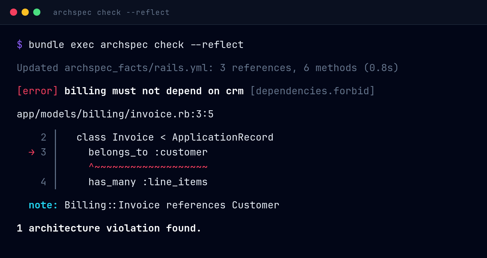

ArchSpec 1.2 checks the dependencies Rails only resolves at runtime. `belongs_to :customer` never names `Customer`, a custom validator is found by convention, and a concern can decide at runtime what it mixes in. ArchSpec now asks your booted app once, saves what Rails resolved, and enforces your boundaries on it with the same static checks as everything else. This release also brings ERB views into components, a todo file that survives refactors, and a much more complete model of ActiveSupport concerns.

## New

- **Rails reflection makes runtime dependencies checkable.** Add `reflect :rails` to `Archspec.rb` and run `archspec reflect`. It boots the app in a separate process and records association targets, custom validators, and conditional concern effects in `archspec_facts/`. `check` and `explain` enforce those facts without booting anything, and an edited model or configuration change fails the check as `facts.stale` until you regenerate. See the [Rails reflection guide](https://archspecrb.dev/association-reflection/). By @crmne ([#31](https://github.com/crmne/archspec/pull/31)).
- **`archspec check --reflect` refreshes stale facts for you.** Locally, it reruns only the producers whose facts are missing or stale, then checks. Declare `reflect :rails, auto: true` to make that the default. Without either, checks still never boot the app, so CI stays strict. By @crmne ([#31](https://github.com/crmne/archspec/pull/31)).
- **Facts producers for any framework.** A gem or project can register its own producer with `ArchSpec.producer` to record references, methods, mixins, and gaps that its macros create, and `archspec reflect` runs it alongside Rails. See [Framework integrations](https://archspecrb.dev/framework-integrations/). By @crmne ([#31](https://github.com/crmne/archspec/pull/31)).
- **ERB views can be components.** `component :views, in: "app/views/**/*.erb"` plus `views.cannot_use :models` now works, powered by [Herb](https://herb-tools.dev/). By @radanskoric ([#36](https://github.com/crmne/archspec/pull/36)).
- **ActiveSupport concerns are modeled on their consumers.** Methods and mixins from `included`, `prepended`, and `class_methods` blocks now belong to each class that includes the concern, and callback calls resolve against the consumer's API. By @crmne; thanks @Halvanhelv ([#23](https://github.com/crmne/archspec/issues/23)) and @jbockler ([#27](https://github.com/crmne/archspec/issues/27)). Analysis stays as fast as 1.1 on large apps thanks to @MatheusRich ([#37](https://github.com/crmne/archspec/pull/37)).
- **`archspec check --check-todo` keeps the burn-down list honest.** It fails when the todo lists violations that no longer occur, and the todo file no longer changes when an edit only shifts line numbers. By @jbockler ([#34](https://github.com/crmne/archspec/pull/34)), with a follow-up by @crmne ([#43](https://github.com/crmne/archspec/pull/43)).
- **`descendants_of:` selects `Data.define` and `Struct.new` classes.** By @meganemura ([#53](https://github.com/crmne/archspec/pull/53)).
- **Rake tasks are analyzed** when a component's patterns select `.rake` files. By @crmne ([#24](https://github.com/crmne/archspec/issues/24)).

## Fixed

- **`except:` now applies to `descendants_of:` components.** By @MatheusRich ([#42](https://github.com/crmne/archspec/pull/42)); thanks @n-rodriguez ([#29](https://github.com/crmne/archspec/issues/29)).
- **Components in default-ignored directories, such as `vendor/engines/`, are analyzed** when a component names them. By @crmne ([#44](https://github.com/crmne/archspec/pull/44)); thanks @n-rodriguez ([#28](https://github.com/crmne/archspec/issues/28)).
- **`can_only_use` and `can_only_be_used_by` accept a reference that one allowed component claims.** A model that also belongs to a second component, such as `records`, no longer turns an allowed reference into a violation. By @meganemura ([#32](https://github.com/crmne/archspec/pull/32)).

## Known limitations

- **Alpine and other musl systems still compile Rubydex from source,** which needs Rust, Cargo, and Clang. Rubydex does not publish musl builds yet; follow [#21](https://github.com/crmne/archspec/issues/21) and [Shopify/rubydex#806](https://github.com/Shopify/rubydex/issues/806). Thanks @henrikbjorn for the report.
- **Reflected facts describe the runtime that produced them.** Environment variables other than `RAILS_ENV`, external services, database-driven configuration, and path dependencies outside the project are not fingerprinted, so regenerate when those change.
- **`check --reflect` and `auto: true` boot the app** whenever facts need refreshing. Keep them to local runs, and commit `archspec_facts/` or run `archspec reflect` as its own CI step.

## Thanks

@radanskoric, @jbockler, @MatheusRich, @meganemura, @n-rodriguez, @Halvanhelv, and @henrikbjorn.

**Full changelog**: https://github.com/crmne/archspec/compare/v1.1.0...v1.2.0
